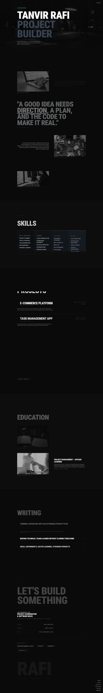

# Tanvir Rafi — Project Management & Software

A responsive personal portfolio for Tanvir Rafi, presenting his background as a project-minded developer who turns ideas into working software. The site brings together an introduction, skills, selected projects, education, writing topics, and contact information in a dark, editorial-style single-page layout.

## Preview



## Features

- Responsive single-page portfolio with section navigation
- Animated page content and scroll-based transitions
- About, skills, projects, education, and writing sections
- Contact details and downloadable CV
- Dark visual style with grayscale imagery and textured overlay

## Built with

- React 18 and TypeScript
- Vite
- Tailwind CSS
- Framer Motion
- Radix UI and shadcn/ui components

## Getting started

You’ll need Node.js and npm installed.

1. Install the dependencies:

   ```sh
   npm install
   ```

2. Start the development server:

   ```sh
   npm run dev
   ```

3. Open the local URL printed by Vite in your browser.

## Available scripts

| Command | Description |
| --- | --- |
| `npm run dev` | Start the Vite development server |
| `npm run build` | Create a production build in `dist/` |
| `npm run build:dev` | Create a development-mode build |
| `npm run preview` | Serve the production build locally |
| `npm run lint` | Run ESLint |

## Updating portfolio content

The portfolio content is defined in its section components:

- `src/components/Hero.tsx` — name, introduction, and availability
- `src/components/About.tsx` — biography
- `src/components/Skills.tsx` — skill groups
- `src/components/Work.tsx` — project descriptions and technologies
- `src/components/Education.tsx` — education and applied learning
- `src/components/Writing.tsx` — writing topics
- `src/components/Contact.tsx` — contact details and CV link

Images and the CV served by the site are stored in `public/`.